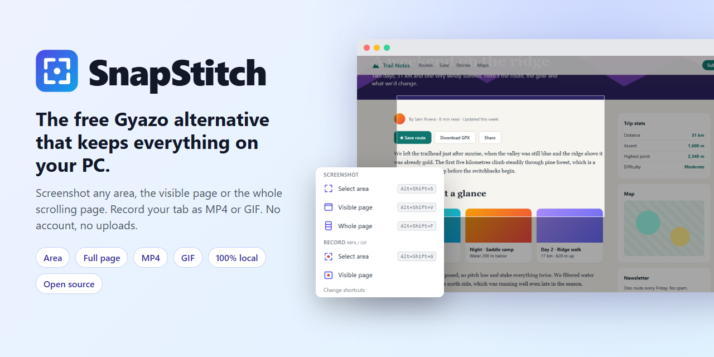
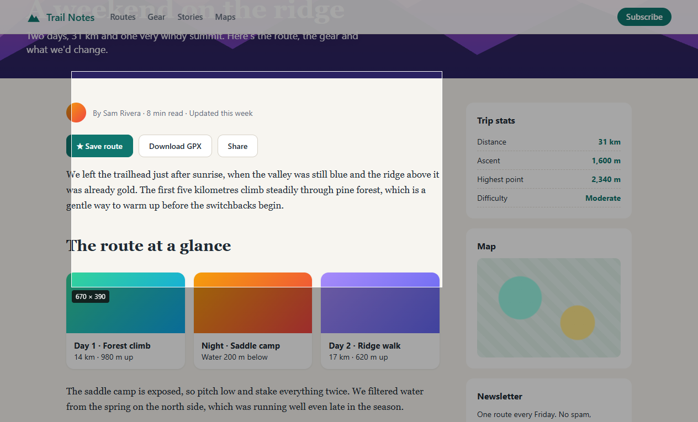
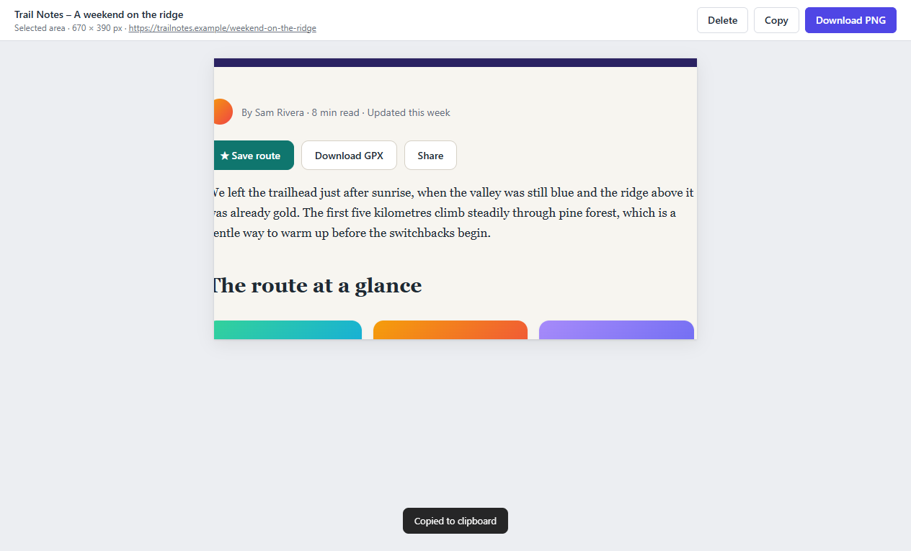
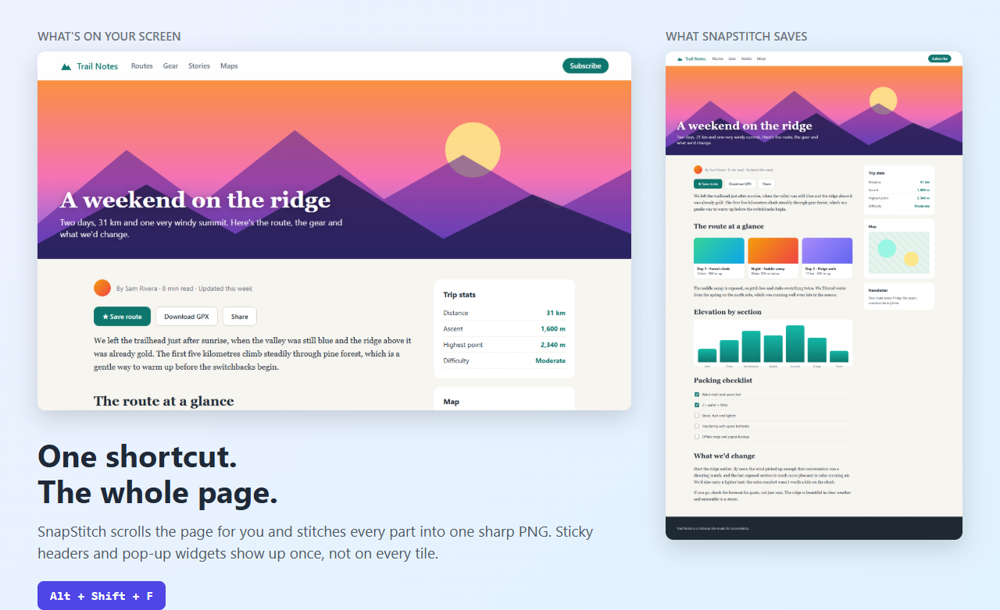
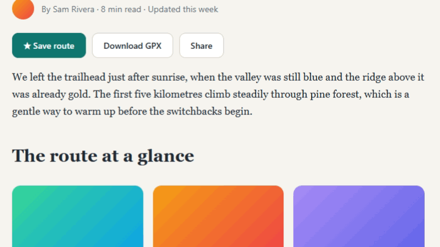
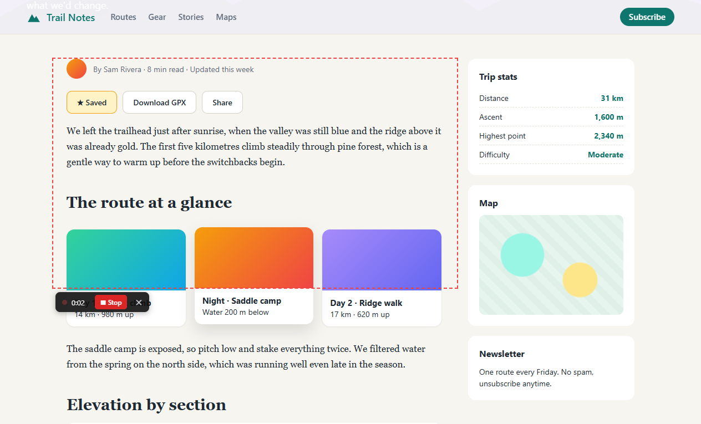
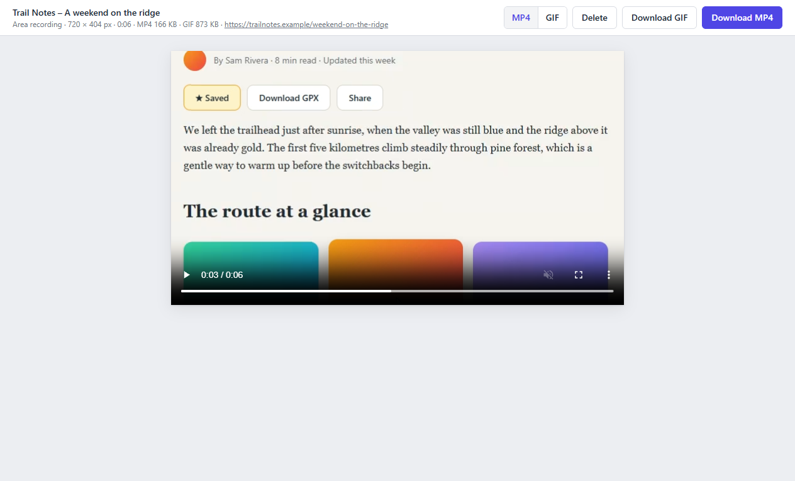
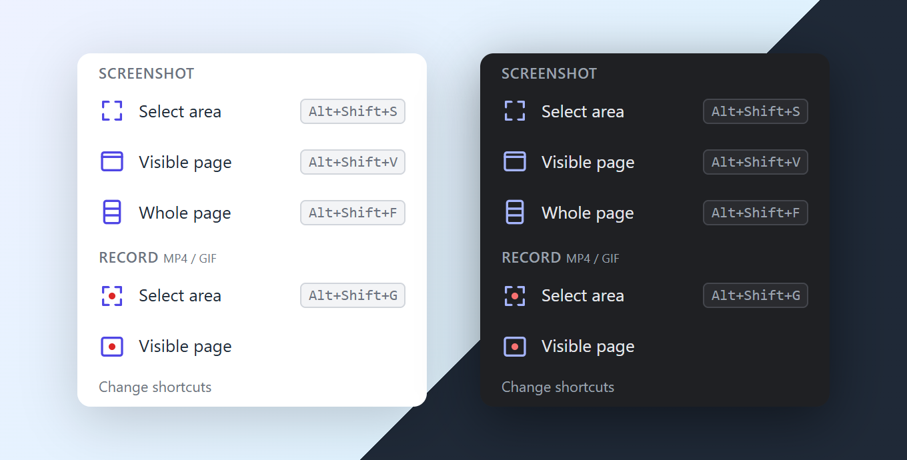

<p align="center">
  
</p>

<h1 align="center">SnapStitch: free screenshot and screen recorder for Chrome</h1>

<p align="center">
  <b>A private, open-source Gyazo alternative. Screenshot an area, the visible page or the whole scrolling page, and record your tab as MP4 or GIF.<br>Everything stays on your PC: no account, no uploads, no watermark.</b>
</p>

<p align="center">
  
  
  
  
  
</p>

<p align="center">
  <a href="#install-in-2-minutes">Install</a> ·
  <a href="#features">Features</a> ·
  <a href="#how-snapstitch-compares">Compare</a> ·
  <a href="#privacy-and-security">Privacy</a> ·
  <a href="#faq">FAQ</a> ·
  <a href="#for-developers">Developers</a>
</p>

---

**SnapStitch** is a free browser extension for taking screenshots and making screen recordings in Google Chrome, Microsoft Edge, Brave and other Chromium browsers. It does what Gyazo, Lightshot, Awesome Screenshot, GoFullPage, Nimbus, Loom and Screencastify do for quick captures, with one difference: **your captures never leave your computer.** There's no cloud, no sign-up and no tracking. The extension makes no network requests at all.

- **Screenshot a dragged area.** It's copied to your clipboard right away, ready to paste into Slack, Discord, email or docs.
- **Screenshot the visible page** with one shortcut.
- **Screenshot the whole page.** SnapStitch scrolls for you and stitches everything into one sharp PNG, with no repeated sticky headers.
- **Record your screen as MP4 or GIF.** Record a dragged area or the full visible page. A pointer and click rings are drawn in, which makes tutorials and bug reports easy to follow.
- **Capture your whole Windows desktop too** with the optional **SnapStitch Desktop** tray app: any app, any monitor, with `PrtSc`. Every desktop capture opens in the same preview tab in your browser.
- **Free and open source** (MIT). The extension is about 70 KB, needs no build step, and you can read every line.

## Features

### Screenshot any area, copied to the clipboard automatically

Press `Alt+Shift+S`, drag a box, done. The screenshot opens in a preview tab with **Copy** and **Download PNG** buttons. It's already on your clipboard, so you can paste it straight away.

<p align="center">
  
  
</p>

### Full-page screenshot (scrolling screenshot)

Press `Alt+Shift+F` to capture the **entire page**, top to bottom, in one image. SnapStitch scrolls through the page, captures each part and stitches the parts together pixel for pixel, at any Windows display scaling or browser zoom. It's tested at 100% and 150%. Sticky headers appear once, and floating chat buttons and pop-ups don't repeat on every tile.

<p align="center">
  
</p>

### Screen recorder: MP4 and GIF from one recording

Press `Alt+Shift+G` and drag an area, or choose **Record visible page** in the popup. A dashed outline and a small **Stop** bar appear *outside* the area, so neither ends up in your video. Stop with the bar, the toolbar icon, or `Alt+Shift+G` again.

You get **both an MP4 and a GIF** from the same recording. Pick either one, or both, in the preview tab.

<p align="center">
  
  <br><sub>This GIF was recorded with SnapStitch: the pointer, the click ring and the scrolling are all real.</sub>
</p>

<p align="center">
  
  
</p>

- **MP4 (H.264)** at full resolution, up to 30 fps. It's the standard video format that common players and apps can open.
- **GIF** at up to 10 fps and 800 px wide, sized for chats, READMEs and tickets.
- **Drawn mouse pointer and click rings.** Chrome can't include the real pointer when it records a tab, so SnapStitch draws one in.
- **Accurate colors and length.** The video matches how long you recorded.

### Desktop app for Windows: capture any app or screen

The browser can only see its own tabs. **SnapStitch Desktop** is an optional tray app that captures everything else: other programs, the desktop, any of your monitors. It has the same options as the popup and its own `PrtSc` shortcuts:

| Desktop action | Shortcut |
|---|---|
| Screenshot an area (the screen freezes while you drag) | `PrtSc` |
| Screenshot the full screen under the pointer | `Shift+PrtSc` |
| Screenshot all screens in one image | Tray menu |
| Record an area / stop recording | `Ctrl+PrtSc` |
| Record the full screen / stop recording | `Ctrl+Shift+PrtSc` |

Whatever you capture opens **in your browser, in the same preview tab** as browser captures: Copy, Download, or Delete. Area screenshots are already on your clipboard. Recordings give you the same MP4 and GIF, made by the same recorder code, with your real mouse pointer in them. The outline and Stop bar never show up in the video.

Left-click the tray icon for a popup like the extension's; right-click it for settings: which browser and profile captures open in, **Start with Windows**, and **Remove SnapStitch Desktop**. See [Install SnapStitch Desktop](#install-snapstitch-desktop-windows-optional).

### Simple popup and keyboard shortcuts, in light or dark mode

<p align="center">
  
</p>

| Action | Shortcut |
|---|---|
| Screenshot an area | `Alt+Shift+S` |
| Screenshot the visible page | `Alt+Shift+V` |
| Screenshot the whole page | `Alt+Shift+F` |
| Record an area / stop recording | `Alt+Shift+G` |
| Record the visible page | Set your own at `chrome://extensions/shortcuts` |

You can change any shortcut at `chrome://extensions/shortcuts`, or from **Change shortcuts** in the popup.

## How SnapStitch compares

| | **SnapStitch** | Typical cloud screenshot tools |
|---|---|---|
| Price | **Free, no limits** | Often free with limits, or paid |
| Account needed | **No** | Usually |
| Where your captures go | **Your computer only** | The company's servers |
| Watermarks | **Never** | Sometimes on free plans |
| Area, visible and full-page screenshots | **Yes** | Varies |
| Screen recording to MP4 **and** GIF | **Yes** | Varies |
| Works offline | **Yes** | Usually needs a connection |
| Open source, auditable | **Yes (MIT)** | Usually not |

If you want a **free Gyazo alternative**, a **Lightshot alternative without uploads**, a **GoFullPage alternative for full-page screenshots**, or a lightweight **Loom or Screencastify alternative for quick tab recordings** (when you don't need cloud sharing links), SnapStitch is built for you.

## Install in 2 minutes

SnapStitch isn't in the Chrome Web Store yet, so you install it straight from this repository. It's safe, and it takes about 2 minutes:

1. **Download:** click the green **Code** button at the top of this page, then **Download ZIP**.
2. **Unzip** it somewhere permanent, for example `Documents\SnapStitch`. Don't delete the folder afterwards: the browser loads the extension from it.
3. Open your extensions page:
   - Chrome: `chrome://extensions`
   - Edge: `edge://extensions`
   - Brave: `brave://extensions`
4. Turn on **Developer mode** (top-right in Chrome, left sidebar in Edge).
5. Click **Load unpacked** and select the unzipped folder, the one that contains `manifest.json`.
6. **Pin it.** Click the puzzle-piece icon in the toolbar, then click the pin next to **SnapStitch**.

To **update**, download the ZIP again, replace the folder, and click the reload icon on the SnapStitch card in your extensions page.

### Install SnapStitch Desktop (Windows, optional)

Do this after installing the extension. SnapStitch Desktop comes as a normal Windows installer, **SnapStitch-Desktop-Setup.exe**. There's no download for it yet, so you build it once from the folder you unzipped (about 5 minutes):

1. Install [Node.js](https://nodejs.org) (the LTS version) if you don't have it.
2. Open a terminal in the SnapStitch folder and run:
   ```bash
   cd desktop
   npm install      # downloads Electron and the installer builder
   npm run dist     # builds desktop\dist\SnapStitch-Desktop-Setup-1.1.0.exe
   ```
   If it says Electron failed to install, run `node node_modules/electron/install.js` once, then `npm run dist` again.
3. **Double-click `desktop\dist\SnapStitch-Desktop-Setup-1.1.0.exe`.** It installs for your Windows user only (no admin prompt), adds Start menu and desktop shortcuts, and starts the app. Keep the installer if you want to install it on another PC.
4. The first time it starts, it asks **"Start SnapStitch Desktop when Windows starts?"** Choose **Yes** if you want it always ready. You can change this later in the tray menu.
5. On your browser's extensions page, click the **reload** icon on the SnapStitch card. The extension needs one new permission to receive desktop captures. Do it in every browser profile you use it in.
6. **Make the icon easy to reach.** The SnapStitch icon lives next to the clock. Windows hides new icons behind the **^** arrow, so drag it out onto the taskbar. For a taskbar button too, right-click the **SnapStitch Desktop** shortcut on your desktop or in the Start menu and choose **Pin to taskbar**. Clicking it opens the popup, and right-clicking it lists the capture actions.

The app finds the browsers and profiles that have SnapStitch by itself. If you use several, choose one under **Open captures in** in the tray menu. **Automatic** uses your default browser and the profile you used last. While it runs, `PrtSc` captures with SnapStitch instead of copying the screen to the clipboard.

**To update**, build and run the new installer; your settings stay. **To uninstall**, use **Settings → Apps → SnapStitch Desktop → Uninstall**, or **Remove SnapStitch Desktop** in the tray menu. Either way it also unregisters itself from your browsers and from starting with Windows.

Windows may show "Windows protected your PC" for an installer that isn't code-signed and was downloaded from elsewhere. Click **More info → Run anyway**. One you built yourself doesn't get that warning.

> **Requirements:** Chrome 116 or newer. Microsoft Edge, Brave, Opera and Vivaldi use the same engine and should work too (it's tested on Chrome). MP4 recording needs Chrome 126 or newer. Older versions save recordings as WebM instead.

## How to use

**Screenshots:** use a shortcut or the popup. Each screenshot opens in a preview tab:

- **Copy** (`Ctrl+C`) puts the image on your clipboard.
- **Download PNG** (`Ctrl+S`) saves it to your Downloads folder.
- **Delete** (`Delete` key) removes the capture from SnapStitch and closes the tab. To keep it among your recent captures instead, just close the tab.
- Click a wide image to switch between fit-to-window and actual size.

**Recordings:** start with `Alt+Shift+G` (an area) or from the popup (an area or the visible page). While you record, the toolbar icon shows a red timer. To stop, do any of these:

- Press `Alt+Shift+G` again.
- Click the toolbar icon, then **Stop and save**.
- For area recordings, click **Stop** on the bar next to the area.

**Discard** throws a recording away. Closing the tab also stops and saves it. The preview tab plays the result and has **Download MP4** and **Download GIF** buttons.

## Privacy and security

SnapStitch was built for people who don't want their screenshots on someone else's server.

- **No network requests.** The extension never contacts any server. There's no analytics, telemetry, ads or remote code. Manifest V3 doesn't allow remote code anyway.
- **No account.** Nothing to sign up for, nothing to log into.
- **Your files, your disk.** Recent captures are kept in your browser's local extension storage so the preview tab can show them: the 20 latest screenshots and the 5 latest recordings. Older ones are deleted automatically. A capture becomes a file only when you click Download, and it goes to your own Downloads folder.
- **Minimal permissions.** The extension can only touch the tab you're capturing, and only after you click the icon or press a shortcut.
- **The desktop app stays offline too.** It blocks every network request, writes each capture to a folder in your user profile, and hands it to the extension through the browser's local native-messaging channel. The folder is deleted as soon as the preview has the capture.

| Permission | Why it's needed |
|---|---|
| `activeTab` | Access to the current tab only, after you click the icon or press a shortcut |
| `scripting` | Shows the selection overlay, scrolls for full-page shots, and tracks the pointer during recordings |
| `clipboardWrite` | Copies screenshots to your clipboard |
| `tabCapture`, `offscreen` | Records the tab in a hidden extension page |
| `storage` | Remembers that a recording is running, for as long as the browser stays open |
| `nativeMessaging` | Receives captures from the SnapStitch Desktop app on your PC, if you install it. Does nothing otherwise |

All the extension's code is in [`src/`](src): about 1,800 lines plus one small open-source GIF encoder. The desktop app is in [`desktop/`](desktop), about 1,400 lines. You're welcome to audit it.

## FAQ

<details>
<summary><b>Is SnapStitch really free?</b></summary>

Yes. It's open source under the MIT license: no paid tier, no limits, no watermark, no ads.
</details>

<details>
<summary><b>Where are my screenshots and recordings saved?</b></summary>

On your computer. Recent captures stay in the browser's local storage so they can be shown in the preview tab. When you click **Download**, the file is saved to your normal Downloads folder. Nothing is uploaded.
</details>

<details>
<summary><b>How do I take a full-page screenshot in Chrome?</b></summary>

Install SnapStitch and press `Alt+Shift+F`, or click the toolbar icon and choose **Whole page**. It scrolls the page, stitches it into one PNG and opens it in a preview tab, ready to download.
</details>

<details>
<summary><b>How do I record my screen as a GIF or MP4 in Chrome?</b></summary>

Press `Alt+Shift+G` and drag the area you want, or choose **Record → Visible page** in the popup. Press `Alt+Shift+G` again to stop. The preview lets you download the recording as **MP4** or **GIF**.
</details>

<details>
<summary><b>Is it a good Gyazo alternative?</b></summary>

If you liked Gyazo's quick drag-to-capture but don't want your images uploaded or tied to an account, yes. SnapStitch also adds full-page screenshots and MP4 recording, and it has no capture limits.
</details>

<details>
<summary><b>Does it record audio or my whole desktop?</b></summary>

The extension records the current browser tab. For the rest of your screen, install [SnapStitch Desktop](#desktop-app-for-windows-capture-any-app-or-screen) on Windows: it screenshots and records any app, an area or a whole monitor. Neither records sound.
</details>

<details>
<summary><b>Does it work in Microsoft Edge, Brave, Opera or Vivaldi?</b></summary>

It's built on the standard Chromium extension platform (Manifest V3), so it should. Install it the same way, using the browser's own extensions page. It's tested on Google Chrome.
</details>

<details>
<summary><b>Why is there a "developer mode" warning?</b></summary>

Browsers show that for any extension installed from a folder instead of the Web Store. It isn't a sign that anything is wrong. You can read all of SnapStitch's code in this repository.
</details>

## Limitations

- Pages that scroll an inner panel instead of the whole window (some web apps) can only be captured as the visible part.
- Browsers don't let extensions capture their own internal pages (`chrome://`, the Web Store). When you try, a red `!` badge appears on the icon.
- Recordings have no audio and stop on their own after 10 minutes.
- The drawn pointer pauses over embedded content from another site, such as a video player. It also stops after the page navigates, though the recording itself continues.
- To capture local `file://` pages, turn on **Allow access to file URLs** on the extension's details page.
- SnapStitch Desktop is Windows only. An area selection stays on one monitor. Games in exclusive full-screen mode may hide the selection overlay; use borderless windowed mode.

## For developers

SnapStitch is plain JavaScript with no build step and no runtime dependencies besides a bundled copy of [gifenc](https://github.com/mattdesl/gifenc) (MIT).

```
manifest.json         Manifest V3: permissions, shortcuts
src/background.js     service worker: shortcuts, screenshots, stitching, recording control
src/page-fns.js       functions injected into the page for full-page capture
src/overlay.js        drag-to-select overlay (screenshots and recordings)
src/recorder.*        hidden page that records: tab capture, crop, pointer, MP4 + GIF
src/gif-worker.js     GIF encoding in a worker
src/ticker.js         steady clock so the recorder makes frames even on still pages
src/rec-ui.js         in-page part of a recording: pointer tracking, area outline, Stop bar
src/db.js             IndexedDB storage for recent captures
src/rec-core.js       recording pipeline shared with the desktop app
src/popup.*           toolbar popup
src/preview.*         preview tab (copy, download, delete)
src/desktop-import.js receives desktop captures from the native messaging host
test/                 end-to-end tests and the README screenshot generator
docs/chrome-notes.md  Chrome behaviors the code relies on (read before changing capture code)

desktop/              SnapStitch Desktop (Electron): tray, PrtSc shortcuts, screen capture
desktop/main.js       tray, popup, shortcuts, area selection, recording control, hand-off
desktop/capture.js    screenshots of each monitor, crops, all-screens image
desktop/overlay.*     frozen-screen area selector, one per monitor
desktop/recorder.*    hidden page that records a monitor with src/rec-core.js
desktop/host/         native messaging host: streams a capture to the preview tab
desktop/browsers.js   finds the browser profiles that have SnapStitch
desktop/setup.js      registers the host with Chrome, Edge and Brave
desktop/build/        installer icon and uninstall clean-up (electron-builder, `npm run dist`)
docs/desktop-notes.md Windows and Electron behaviors the desktop app relies on
```

**Run the tests.** They load the real extension into Chrome for Testing and drive it through the toolbar popup, the same way a user would:

```bash
cd test
npm install      # downloads Chrome for Testing the first time (~170 MB)
npm test         # 30 checks at 1x and 1.5x display scaling
ONLY=record npm test   # run a subset
```

The tests check images and videos pixel by pixel:

- Every stitched row appears exactly once.
- Crops are exact.
- Video colors and length are right.
- The drawn pointer follows the mouse.
- The recording outline never bleeds into the video.

**Desktop app tests:**

```bash
cd desktop
npm test             # native host protocol + pixel checks of crops and the all-screens image
npm run self-test    # on your real screens: capture, record, open through the real host (quit the app first)
npm start            # run from source instead of installing
```

**Regenerate the README images** with `npm run shots`. It drives the extension on a fictional demo page (`test/fixtures/demo-page.html`).

Contributions are welcome. Please run `npm test` before opening a pull request, and read [docs/chrome-notes.md](docs/chrome-notes.md) if you touch capture or recording code.

## License

[MIT](LICENSE) © ImMike. The bundled [gifenc](https://github.com/mattdesl/gifenc) is MIT © Matt DesLauriers.

<sub>SnapStitch is an independent project, not affiliated with or endorsed by Gyazo, Lightshot, Awesome Screenshot, GoFullPage, Nimbus, Loom, Screencastify, Google or Microsoft. All product names are trademarks of their respective owners and are used only to describe compatibility and alternatives.</sub>

<sub>Keywords: free screenshot extension, Gyazo alternative, full page screenshot Chrome, scrolling screenshot, screen recorder Chrome extension, record screen to GIF, MP4 screen recorder, private screenshot tool, no upload, offline, open source, Edge, Brave.</sub>
